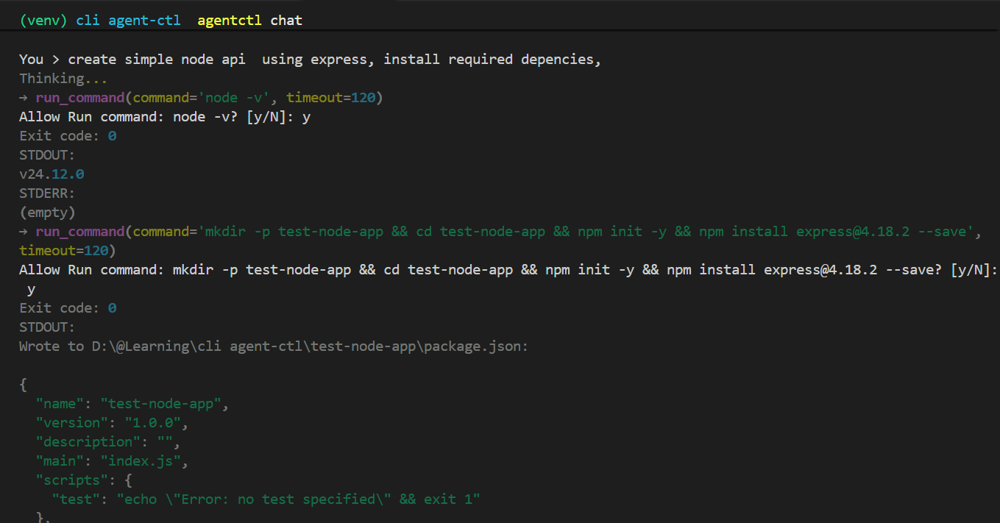

# agentctl

A simple CLI coding agent in Python (powered by Groq) that reads, edits, searches, and runs code from your terminal.

## Demo



## How It Works

```
Task → LLM → Tool call → Result → LLM → ... → Final Answer
```

You give a task. The agent calls tools in a loop (max 30 steps), checks the results, and streams the answer to your terminal.

## Features

- **Agent loop** with tool calling
- **Live streaming** of Markdown answers
- **Chat mode** with saved, resumable sessions
- **`@` file mentions** with autocomplete
- **Safe by default:** file access stays inside your project, and risky actions ask for `y/n` confirmation

## Tools

| Tool            | What it does                   |
| --------------- | ------------------------------ |
| `read_file`     | Read a file                    |
| `write_file`    | Create or overwrite a file     |
| `edit_file`     | Replace text in a file         |
| `create_folder` | Create a folder                |
| `delete_file`   | Delete a file                  |
| `delete_folder` | Delete a folder                |
| `list_files`    | List files in a folder         |
| `search_files`  | Search text across the project |
| `run_command`   | Run a shell command            |

Writing, editing, deleting, and running commands need your approval.

## Quick Start

```powershell
# 1. Set up
python -m venv venv
.\venv\Scripts\Activate.ps1      # macOS/Linux: source venv/bin/activate
pip install -e ".[dev]"

# 2. Add your Groq API key
copy .env.example .env           # then put your key in .env
```

## Usage

```powershell
# One-shot
agentctl "what does src/agentctl/config.py do?"

# Chat mode
agentctl chat

# Resume a saved session
agentctl chat --session demo

# Skip confirmations
agentctl "add a function add(a, b) to math_utils.py and test it" --yes
```

In chat, type `@` to pick a file and `exit` to quit.

## Learn How It's Built

Want to build your own? The **[step-by-step guide](docs/GUIDE.md)** walks through it in 7 phases:

| Phase | You build                | Main files            |
| ----- | ------------------------ | --------------------- |
| 1     | Call the LLM             | `config.py`, `llm.py` |
| 2     | CLI wrapper              | `cli.py`              |
| 3     | First tool + agent loop  | `agent.py`, `tools/`  |
| 4     | Remaining tools + safety | `tools/`              |
| 5     | Saved sessions           | `history.py`          |
| 6     | Streaming + chat mode    | `llm.py`, `cli.py`    |
| 7     | Tests + polish           | `tests/`, README      |

The core idea is a loop: **ask the LLM → run the tool it requests → send back the result → repeat until done.**

## Project Structure

```text
src/agentctl/
├── cli.py        # CLI and chat mode
├── agent.py      # Agent loop
├── llm.py        # Groq client + streaming
├── history.py    # Save/load sessions
├── config.py     # Settings
├── prompts.py    # System prompt
└── tools/        # One file per tool
docs/GUIDE.md     # Build guide
tests/            # Pytest tests
```

## Tests

```powershell
pytest -v
```

## Limitations

- `run_command` has no sandbox. Your confirmation is the only protection.
- Only Groq is supported.
- No cost tracking or automatic undo.

## License

MIT
