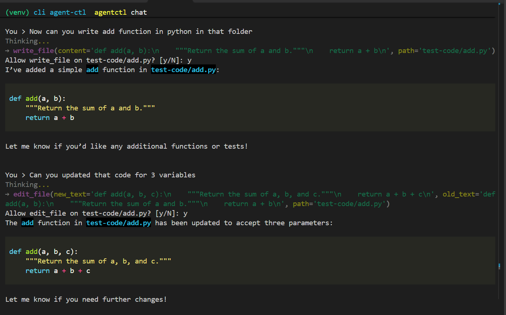

# agentctl

A simple CLI coding agent in Python (powered by Groq) that reads, edits, searches, and runs code from your terminal.

## Demo



## How It Works

You give a task. The agent thinks, calls tools in a loop (up to `MAX_STEPS = 30`), checks the output, and streams the final Markdown answer to your terminal.

```
Task → LLM (Groq) → Tool call → Result → LLM → ... → Final Answer
```

## Features

- **Provider:** Groq SDK (`groq`) using `openai/gpt-oss-20b` (configured in `src/agentctl/config.py`)
- **Agent Loop:** Tool-calling loop in `src/agentctl/agent.py` with `MAX_STEPS = 30`
- **Live Streaming:** Streams formatted Markdown responses directly in the terminal (`rich`)
- **Interactive Chat & Sessions:** `agentctl chat` and `--session` loops with JSON history saved under `sessions/` and automatic history compaction
- **`@` File Mentions:** Type `@` in chat mode for live folder/file autocomplete (`prompt_toolkit`), highlighted inline as `@filename` while sending the full relative path to the model
- **Safety:**
    - All file paths are restricted to the current working directory
    - Tool outputs longer than 10,000 characters are truncated
    - `write_file`, `edit_file`, and `run_command` ask for `y/n` confirmation unless `--yes` (`-y`) is passed

## Tools

| Tool           | What it does                                                                                                    |
| -------------- | --------------------------------------------------------------------------------------------------------------- |
| `read_file`    | Read a file, optionally by 1-based `start_line` and `end_line`                                                  |
| `write_file`   | Create or overwrite a file (requires confirmation)                                                              |
| `edit_file`    | Replace exactly one `old_text` match with `new_text` (requires confirmation)                                    |
| `list_files`   | List files in a folder, skipping `.git`, `node_modules`, `__pycache__`, `.venv`, `venv`                         |
| `search_files` | Plain-text search returning `file:line: text` matches (max 50)                                                  |
| `run_command`  | Run a shell command with timeout (default 30s) and return exit code, stdout, and stderr (requires confirmation) |

## Installation

1. Create and activate a virtual environment (Python 3.10+):

    ```powershell
    python -m venv venv
    .\venv\Scripts\Activate.ps1
    ```

2. Upgrade `pip` (if needed) and install `agentctl` in editable mode with dev dependencies:

    ```powershell
    python -m pip install --upgrade pip
    pip install -e ".[dev]"
    ```

3. Copy `.env.example` to `.env` and add your Groq API key:

    ```powershell
    copy .env.example .env
    ```

    Edit `.env`:

    ```env
    GROQ_API_KEY=your-key-here
    ```

## Usage

### One-shot mode

```powershell
agentctl "what does src/agentctl/config.py do?"
agentctl "tell me the 7th line of @cli.py"
```

Skip confirmation prompts for writes/edits/commands with `--yes` (`-y`):

```powershell
agentctl "Add a function add(a, b) to math_utils.py and write a test for it, then run the tests." --yes
```

### Interactive chat mode

```powershell
agentctl chat
```

Inside chat mode:

- Type `@` to browse and autocomplete project files/folders
- Type `exit`, `quit`, `q`, or press `Ctrl+C` / `Ctrl+Z` (then Enter) to exit

### Resumable named sessions

Open or resume a saved session in an interactive loop (`sessions/<name>.json`):

```powershell
agentctl --session demo
agentctl chat --session demo --yes
agentctl "what does @config.py do?" --session demo
```

## Project Structure

```text
├── pyproject.toml
├── README.md
├── .env.example
├── .gitignore
├── src/
│   └── agentctl/
│       ├── __init__.py
│       ├── cli.py          # Typer CLI, @path autocomplete, live Markdown streaming
│       ├── agent.py        # Agent loop (MAX_STEPS limit)
│       ├── llm.py          # Groq streaming client + tool-call assembly
│       ├── history.py      # History compaction + JSON save/load
│       ├── config.py       # Settings (model, MAX_STEPS, sessions dir, API key)
│       ├── prompts.py      # System prompt
│       └── tools/
│           ├── __init__.py # Tool registry, path safety, truncation, confirmations
│           ├── read_file.py
│           ├── write_file.py
│           ├── edit_file.py
│           ├── list_files.py
│           ├── search_files.py
│           └── run_command.py
├── sessions/               # Saved JSON chat histories (gitignored)
└── tests/
    └── test_tools.py       # Pytest suite for all tools and safety rules
```

## Running Tests

```powershell
pytest -v
```

## Limitations

- **`run_command` has no sandbox:** Approved shell commands execute directly on your machine; your `y/n` confirmation (disabled by `--yes`) is the only protection.
- **Path safety does not constrain shell commands:** Path checks restrict the file tools (`read_file`, `write_file`, `edit_file`, `list_files`, `search_files`) to the current working directory, not arbitrary commands you approve in `run_command`.
- **Single provider and model:** Only Groq (`openai/gpt-oss-20b` in `src/agentctl/config.py`) is supported out of the box.
- **No cost tracking or general retries:** Token usage and API cost are not tracked, and only malformed tool-call stream errors retry once (no general network/rate-limit backoff).
- **No automatic rollback:** Edits and writes modify files in place without an automatic undo or git diff preview.

## License

MIT
